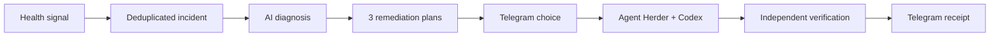

# NoticePlace

[Website](https://notify.bezrabotnyi.com/) · [Landing source](web/landing/) · [Landing deployment](docs/public-landing.md)

[Русский](README.ru.md) · [中文](README.zh.md) · [Docs](docs/)


> Your agents keep working. You get the decision and the result in Telegram.

Notice Place is the policy and application layer for agent-to-human notifications,
questions, and escalation, exposed through one authenticated API and MCP. It
routes approved delivery through UserIO, the universal communications gateway;
available operations depend on the account and channel capabilities. Agent
session resumption remains an Agent Herder responsibility.

NoticePlace turns failures and long agent jobs into one visible flow: detect →
diagnose → offer plans → let a human choose → run Codex through Agent Herder →
verify independently → report the outcome.



- Host CPU, RAM, disk, failed services, logs and keywords
- Durable incidents, deduplication, retries and trace IDs
- Human choice with signed Telegram buttons
- Codex, OpenCode, Hermes and GPTAdmin agent jobs
- Useful-progress supervision, not heartbeat-only checks
- Independent verification before resolution
- Telegram delivery and legacy installed Matrix/Android adapters, migrating to
  the UserIO-owned transport boundary
- AskHuman MCP, producer SDKs and protected operator console

## Install

```bash
codex mcp add notify -- npx -y github:megamen32/noticeplace
```

Read the [communications architecture](docs/communications-architecture.md)
before choosing a transport. For a new integration, call MCP tool `noticeplace_instructions` or
`GET /v1/instructions`; both return the same short, secret-free producer
contract. See the [complete feature list](docs/features.md), [production deployment](deploy/README.md), [producer API](docs/producer.md), and [agent jobs](docs/gptadmin-agent-jobs.md).

MIT
