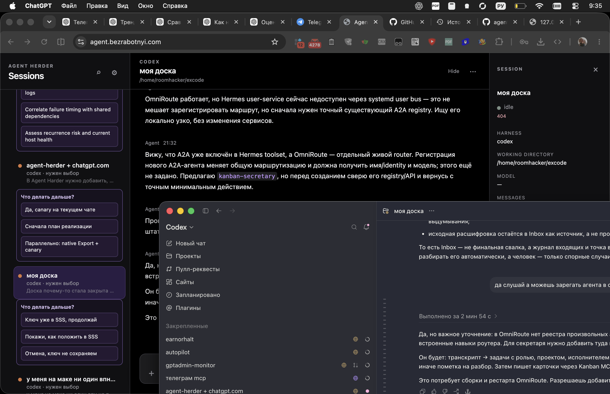
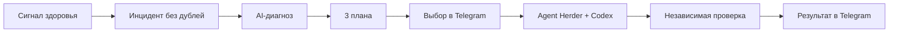

# NoticePlace

[Сайт](https://notify.bezrabotnyi.com/) · [Исходники лендинга](web/landing/) · [Публикация и откат](docs/public-landing.md)

[English](README.md) · [中文](README.zh.md) · [Документация](docs/)



> Агенты продолжают работать. Решение и результат приходят вам в Telegram.

Notice Place — слой политик и приложения для уведомлений, вопросов и
эскалации от агентов к людям. Внешний вход — один аутентифицированный API и
MCP. Одобренная доставка проходит через UserIO — универсальный шлюз
коммуникаций; доступные операции зависят от аккаунта и возможностей канала.
Возобновлением сессий агентов занимается Agent Herder.

NoticePlace объединяет сбои и долгие агентские задачи в понятный поток:
обнаружить → диагностировать → предложить планы → получить выбор человека →
запустить Codex через Agent Herder → независимо проверить → сообщить результат.



- CPU, RAM, диск, failed services, логи и ключевые слова
- Инциденты, дедупликация, повторы и trace ID
- Подписанные кнопки выбора в Telegram
- Codex, OpenCode, Hermes и GPTAdmin jobs
- Supervisor полезного прогресса, а не heartbeat
- Закрытие только после независимой проверки
- Доставка в Telegram и оставшиеся в установленных версиях legacy-адаптеры
  Matrix/Android с переходом на транспортную границу UserIO
- AskHuman MCP, SDK продюсера и защищённая админка

## Установка

```bash
codex mcp add notify -- npx -y github:megamen32/noticeplace
```

[Архитектура коммуникаций](docs/communications-architecture.md) · [Все функции](docs/features.md) · [Production deploy](deploy/README.md) · [API](docs/producer.md) · [Agent jobs](docs/gptadmin-agent-jobs.md)

MIT
