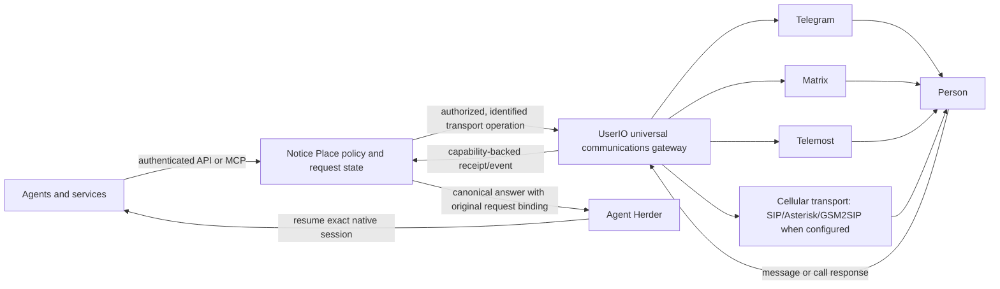

# Communications architecture and ownership

This is the authoritative product-boundary document for Notice Place. It
describes the target architecture and separates it from adapters that remain
in the installed Notice Place release. The corresponding UserIO boundary is
documented in [UserIO Communications Architecture](https://github.com/megamen32/universal-userio/blob/main/docs/COMMUNICATIONS-ARCHITECTURE.md).

## Target request and transport flow

Notice Place provides the public API and MCP entry point for agent
notifications, questions, acknowledgements, and escalation policy. Producers
do not call channel providers, UserIO internals, AgentCall, Asterisk, or phones
directly. Notice Place authenticates producers and decides whether, when, and
to whom a user request may be delivered.

UserIO is the communications gateway for messages, chats, history, files, and
calls across its supported channels. It owns per-account authorization,
channel capabilities, provider operations, and transport/call lifecycle
receipts. Telegram, Matrix, Telemost, and SIM/GSM2SIP are distinct channels;
the list does not promise that every account or channel supports every
operation. Check the actual UserIO account capability before selecting a
transport.

AgentCall is an internal UserIO voice AI/audio implementation, not another
public product or a parallel caller API. Asterisk and GSM2SIP belong only to
the cellular/SIP path. Matrix and Telemost are separate channels and are not assumed or required to use the cellular Asterisk chain. The diagram does not assert which physical leg handled any particular call.

## Ownership boundaries

| Component | Owns | Does not own |
| --- | --- | --- |
| Notice Place API and MCP | Producer authentication; recipient/actor authorization; notification and human-question policy; consent, schedules, quiet hours, mute, deduplication, canonical request/answer state, Telegram fallback, and end-to-end request correlation | Provider credentials; channel account permissions; media processing; the physical call leg; native session execution |
| UserIO | Per-account channel authorization and capability; message/call transport; media and voice lifecycle; provider receipts and inbound event projection | Notice Place human-question consent/schedule policy; deciding which agent question deserves a call; resuming a coding session |
| AgentCall | Internal UserIO voice-AI/audio implementation where installed and enabled | Public producer API, Notice Place policy, a distinct transport owner, or proof that another channel/phone answered |
| Asterisk and GSM2SIP | Cellular/SIP transport components when that route is configured | Telegram, Matrix, or Telemost transport; Notice Place policy; canonical question state |
| Agent Herder | Exact native session binding and resumption | Notice delivery policy or channel transport |

For an AskHuman call, Notice Place binds one stable request to one native
session, authorizes and schedules delivery, and keeps Telegram actionable as a
fallback. UserIO executes only a capability-authorized transport operation
and returns its available lifecycle evidence. Notice Place stores an
explicitly confirmed answer on that same request. Agent Herder alone resumes
the bound session.

## Identity, idempotency, and delivery states

Carry the same Notice Place request identity through each layer wherever the
transport contract supports correlation. Reuse an idempotency key only for an
exact replay of the same operation. If a transport has accepted an operation
but its result is unknown, reconcile that operation by its stable identity;
do not create a fresh send or call to guess whether the first one happened.

These states are different and must not be collapsed:

- **Accepted by Notice Place** means the request was durably stored. For
  `/v1/events`, HTTP `202` does not mean a person has seen it.
- **Accepted by UserIO or a provider** means the transport accepted a request;
  it is not evidence of delivery, ringing, or answer.
- **Sent/originated**, **ringing**, and **answered** may be reported only when
  the corresponding channel provides a correlated receipt/event.
- **Confirmed human answer** means the person explicitly confirmed the
  read-back for that specific question request. A transcript, delivery
  receipt, call answer, or incident acknowledgement is not a canonical answer.
- **Session resumed** requires Agent Herder's receipt for the exact bound
  native session.

If a channel cannot report one of these states, keep it unknown. Do not infer
it from service health, an active listener, or a successful response from a
different layer.

## Source and installed state

As observed on 2026-10-20, the Notice Place source still contains legacy direct
Matrix and Android delivery adapters and settings. Preserve their operational
contracts while migrating; their presence describes compatibility code, not
the target transport owner. New integrations should use Notice Place API/MCP
and the authorized UserIO transport boundary. Migration is not complete until
the deployed Notice Place runtime uses that boundary for the relevant
operation.

For this worktree, the installed Notice Place release link still points to
`a15de07`; the PR changes are not deployed. The `userio-voice` container and
AgentCall bridge were observed running, and the user confirms that a call
reached them. No provider call receipt was correlated to that report, so its
physical channel/leg remains unknown. The installed AgentCall prepare request
starts a spoken greeting and a two-way voice session; source inspection did
not establish bounded one-way TTS-with-hangup or DTMF question confirmation.
The experimental Notice Place question-call protocol in PR #5 is not installed
and must not be presented as a production capability.
